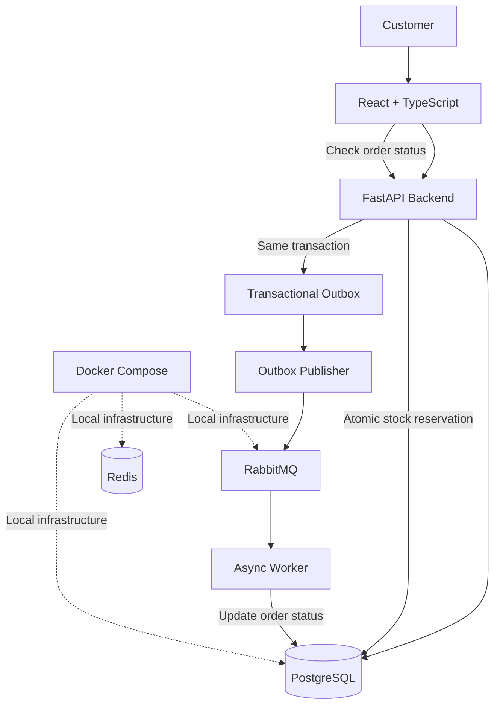

# GoML Flash Sale

**A concurrency-safe flash-sale checkout system built with React, FastAPI, PostgreSQL, RabbitMQ, and Redis.**

## 🚀 Project Links

- **Live Website:** [GoML Flash Sale](https://go-ml-flash-sale.vercel.app/)
- **Source Code:** [GitHub Repository](https://github.com/pututu1212/GoML-Flash-Sale)

> **First-visit note:** The hosted backend may take a little time to wake up after a period of inactivity. The first request may be slower than subsequent requests. If the website initially appears delayed, please allow a short wait before retrying.

---

## 1. Overview

A flash sale can generate a large number of checkout requests within a short period. When many customers compete for limited inventory, the system must prevent overselling, handle retries safely, and process orders reliably.

This project implements an asynchronous checkout flow with atomic inventory reservation, idempotency keys, a transactional outbox, and RabbitMQ-based background processing.

The focus is on correctness under concurrent requests, clear separation between checkout acceptance and order processing, and a foundation for further performance testing.

## 2. Architecture



### Checkout flow

1. The customer submits a checkout request through the frontend.
2. FastAPI checks the idempotency key to prevent duplicate orders on retries.
3. PostgreSQL atomically reserves one unit of inventory only if stock is available.
4. The order is stored as `pending`, and an `order.created` event is inserted into the outbox in the same transaction.
5. The outbox publisher sends unpublished events to RabbitMQ and marks them published after broker confirmation.
6. The background worker consumes the event and updates the order to `confirmed`.
7. The client can retrieve the order status through the API.

### Why use a transactional outbox?

Saving an order and publishing a message are two separate operations. If the application crashes between them, an order might exist without its corresponding event being delivered.

The transactional outbox addresses this by saving the order and event together in PostgreSQL. A separate publisher forwards pending events to RabbitMQ. This improves reliability, although retries and duplicate message delivery still need to be handled safely.

Redis is included in the local infrastructure. PostgreSQL remains the source of truth for inventory and orders in the checkout flow described above.

## 3. Features implemented

- **Atomic inventory reservation:** concurrent updates cannot reserve stock that is already unavailable.
- **Idempotent checkout:** repeated requests with the same idempotency key reuse the existing order.
- **Transactional outbox:** order creation and event persistence occur within the same database transaction.
- **Asynchronous order processing:** RabbitMQ separates checkout acceptance from order confirmation.
- **Order status lookup:** clients can check an order using its ID.
- **Sold-out handling:** checkout returns HTTP `409` when stock is unavailable.
- **Containerized infrastructure:** Docker Compose configures PostgreSQL, Redis, and RabbitMQ.
- **Load-testing suite:** k6 scripts cover smoke tests, checkout load, sustained traffic, idempotency, diagnostics, and clean runs.

## 4. Technology stack

| Component | Technology |
|---|---|
| Frontend | React, TypeScript, Vite |
| Backend API | Python, FastAPI |
| Database | PostgreSQL, asyncpg |
| Message broker | RabbitMQ, aio-pika |
| Supporting infrastructure | Redis |
| Background processing | Python asynchronous worker |
| Local environment | Docker Compose |
| Load testing | k6 |

## 5. API endpoints

| Method | Endpoint | Purpose |
|---|---|---|
| `GET` | `/` | API root |
| `GET` | `/health` | Health check |
| `GET` | `/inventory` | View inventory |
| `POST` | `/checkout` | Submit a checkout request |
| `GET` | `/orders/{order_id}` | Retrieve order status |

The checkout endpoint accepts requests asynchronously with HTTP `202`. An accepted order can initially have `pending` status and later become `confirmed`.

## 6. Running locally

### Prerequisites

- Docker Desktop with Docker Compose
- Python and `pip`
- Node.js and npm
- k6, if running load tests

### Step 1 — Configure environment variables

Create a root `.env` file with local development values for `POSTGRES_PASSWORD` and `RABBITMQ_PASSWORD`.

Configure `backend/.env` with the database and RabbitMQ connection URLs expected by the backend and worker. Use the ports and credentials defined in `docker-compose.yml`.

Do not commit or upload real credentials.

### Step 2 — Start infrastructure

From the project root:

```powershell
docker compose up -d
docker compose ps
```

Wait until PostgreSQL, Redis, and RabbitMQ are healthy.

### Step 3 — Install backend dependencies

```powershell
cd backend
python -m venv .venv
.\.venv\Scripts\Activate.ps1
pip install -r requirements.txt
```

Initialize the database schema using the initialization procedure included with the source before starting the API.

### Step 4 — Start the API

From the `backend` directory, with the environment configured:

```powershell
uvicorn main:app --host 127.0.0.1 --port 8000
```

### Step 5 — Start the worker

Open another terminal, change to the `backend` directory, and activate the virtual environment:

```powershell
.\.venv\Scripts\Activate.ps1
python worker.py
```

### Step 6 — Start the frontend

Open another terminal from the project root:

```powershell
cd frontend
npm ci
npm run dev
```

Open the local URL printed by Vite. Ensure the frontend API configuration points to the local backend before testing checkout.

> **Setup note:** Confirm the database initialization procedure and required environment variable names against the included source and configuration before running from a fresh checkout.

## 7. Load testing and observed results

The repository contains k6 scripts and saved JSON summaries from local test runs.

| Test run | Requests recorded | Reported throughput | Reported p95 latency |
|---|---:|---:|---:|
| Smoke test | 20 | ~213.6 req/s | ~88 ms |
| Checkout load test | 100 | ~235.8 req/s | ~244 ms |
| 500-request run | 500 | ~154.6 req/s | ~724 ms |
| Sustained run | 11,950 | ~99.6 req/s | ~80.6 ms |

These results come from separate runs with different conditions and should not be treated as one combined benchmark.

The sustained run recorded 51 dropped iterations. A separate 100-request run also reported p95 latency of approximately 2.23 seconds. Performance therefore varies between runs, and the saved summaries do not establish production-scale capacity.

The checkout flow has also been tested locally for asynchronous order confirmation, idempotent retries, and inventory consistency.

## 8. Scaling roadmap

The next performance milestone is **100,000 requests in 10 seconds, equivalent to 10,000 requests per second**. This is a target for further validation, not a result demonstrated by the current tests.

The next steps are to:

- Establish repeatable load tests using isolated test data and controlled starting inventory.
- Profile API latency, database contention, connection-pool usage, and worker throughput.
- Tune database connection pools and outbox publishing and consumption.
- Monitor queue depth, processing delay, failed requests, and dropped iterations.
- Increase load progressively before attempting the full target.
- Evaluate horizontal API and worker scaling in a controlled distributed test.

The objective is to increase throughput while preserving inventory correctness, idempotency, and acceptable latency.

## 9. Known limitations

- The 100k-request target has not yet been demonstrated.
- Saved performance results vary between runs, and the sustained test recorded dropped iterations.
- The performance evidence is from development testing, not a production-scale benchmark.
- Redis is available in the infrastructure, but the checkout consistency guarantees described here rely on PostgreSQL and the transactional outbox.
- The hosted backend may experience a cold-start delay after inactivity.

## Project links

- **Live website:** https://go-ml-flash-sale.vercel.app/
- **GitHub repository:** https://github.com/pututu1212/GoML-Flash-Sale
